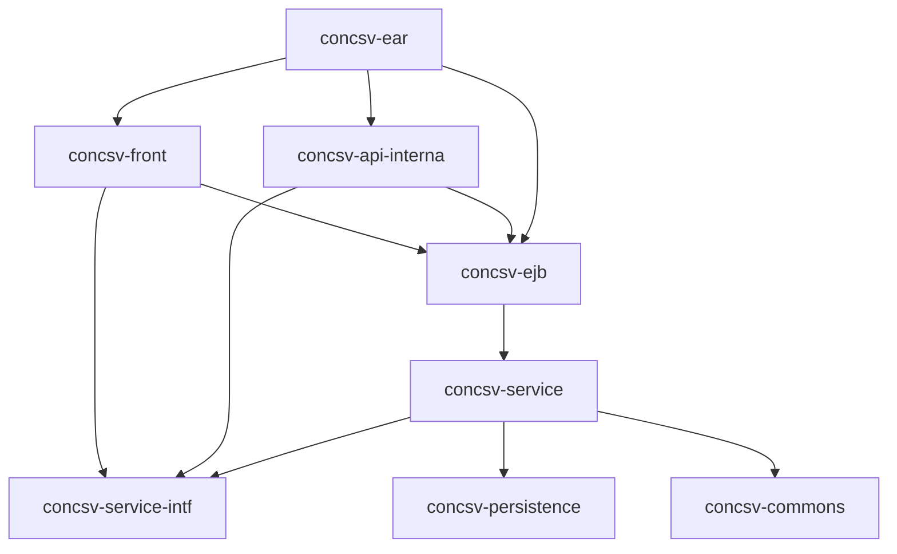

# Arquitectura y módulos

## Plataforma

| Elemento | Versión o decisión |
| --- | --- |
| Lenguaje | Java 11 |
| Runtime | JBoss EAP 7.2.7 |
| Especificación | Java EE 8 |
| Spring | Spring Boot 2.7.18 en el WAR público |
| REST interno | JAX-RS/Jersey 2.35 |
| Configuración | MicroProfile Config 1.3 y ficheros externos |
| Persistencia | JPA 2.2, JTA, Hibernate y Oracle |
| Frontend | React, TypeScript, Vite y Material UI |
| Toolchain frontend | Node 16.17.0 instalado por Maven |
| Empaquetado | EAR 8 con WAR delgados (`skinnyWars`) |

El `pom.xml` raíz actúa como reactor y hereda de
`spring-boot-starter-parent`, pero la aplicación no es un único ejecutable
Spring Boot. El contenedor gestiona EJB, CDI, JTA, JAX-RS y recursos JNDI.

## Módulos

| Módulo | Empaquetado | Responsabilidad |
| --- | --- | --- |
| `concsv-service-intf` | JAR | Contratos remotos/locales, modelos, enums, excepciones y claves de configuración |
| `concsv-commons` | JAR | Configuración común, i18n, filtros REST/CORS y mapeadores de errores |
| `concsv-persistence` | JAR | Entidades JPA y `persistence.xml` de la unidad `concsvPU`; su `PersistenceConfig` Spring es legado y no lo carga este EAR |
| `concsv-service` | JAR | Lógica documental, integraciones, PDF, caché, estadísticas e interceptores |
| `concsv-ejb` | EJB JAR | Fachadas EJB que exponen los servicios del dominio al resto del EAR |
| `concsv-front` | WAR | Aplicación React, API Spring MVC y recursos públicos |
| `concsv-api-interna` | WAR | API JAX-RS, Swagger, monitorización, estadísticas y logs |
| `concsv-ear` | EAR | Ensamblado, manifiesto, context roots e imagen Docker |

## Ensamblado y contextos

`concsv-ear/pom.xml` genera `concsv-ear/target/concsv.ear` con:

| Artefacto | Context root |
| --- | --- |
| `concsv-front.war` | `/concsvfront` |
| `concsv-api-interna.war` | `/concsvapi/interna` |
| `concsv-ejb.jar` | No aplica |

Las bibliotecas compartidas se colocan en `EAR/lib`. El manifiesto incluye
versión, revisión SCM, rama y fecha de construcción. El orden de inicialización
está habilitado y los WAR son delgados.

## Capas y dependencias

`HashServiceInterface` es el contrato documental central. Ofrece consulta por
CSV/UUID, original, imprimible, ENI, metadatos opcionales, exclusiones y
limpieza de caché. `ComandaServiceInterface` concentra salud, estadísticas y
logs. Las fachadas de `concsv-ejb` delegan en implementaciones CDI marcadas con
`@LogicService`.

## Componentes clave

| Componente | Función |
| --- | --- |
| `HashService` | Decide el repositorio, completa `DocumentInfo` y produce contenidos |
| `NewDigitalArchiveService` | Cliente del Archivo Digital nuevo |
| `OldSaveKeepingService` | Cliente SOAP de Custodia Antigua |
| `PrintableUtils` | Convierte PDF/imagen en copia imprimible y añade metadatos |
| `MyDocumentConverter` | Convierte formatos ofimáticos mediante OpenOffice |
| `ValidateSignaturePlugin` | Integra validación de firmas con @firma |
| `CacheHelper` | Serializa información y contenido en filesystem |
| `EstadisticaHelper` | Acumula y persiste contadores de peticiones |
| `SubsistemesHelper` | Estado de subsistemas internos |
| `IntegracionsHelper` | Estado y descripción de integraciones externas |
| `ComandaService` | Adapta salud, estadísticas y logs al modelo de Comanda |

## Ciclo de vida

- JBoss carga propiedades, datasource y seguridad antes del EAR.
- `StartupServiceBean`, `@Singleton @Startup`, confirma el arranque del EJB.
- Los beans CDI `@ApplicationScoped` inicializan configuración y estado local.
- `HashService.init()` carga en memoria el fichero de CSV excluidos. Un error de
  lectura aborta la inicialización del bean.
- Los endpoints invocan fachadas EJB y registran duración/resultado.
- Los acumuladores de estadísticas se vuelcan a Oracle cada cinco minutos y se
  depuran diariamente a las 02:30 mediante temporizadores EJB no persistentes.
- La caché expirada se revisa cada minuto mediante un temporizador EJB que no
  declara `persistent=false`; por tanto usa el valor persistente por defecto.
- `PropertyFileConfigSource` exige que existan las propiedades de sistema con
  las rutas de los dos ficheros; si faltan, falla al cargar la clase.

## Límites arquitectónicos

La base de datos no contiene documentos ni metadatos de negocio: sólo datos de
explotación. Los documentos permanecen en Archivo Digital o Custodia Antigua;
el filesystem local puede contener copias serializadas temporales.

La instancia mantiene estado local en memoria y disco: exclusiones, métricas,
salud acumulada y caché. Por ello la versión 2.1.7 no es stateless ni se puede
escalar horizontalmente sin decisiones adicionales sobre almacenamiento
compartido, afinidad o consistencia.

El contexto Spring del WAR público sólo escanea `es.caib.concsv.front`
(`ConcsvFrontApp`). Por eso las clases de `concsv-persistence`, incluido su
`PersistenceConfig` con unidad `main`, no participan en el arranque de esta
aplicación; la persistencia real del EJB usa `concsvPU` mediante
`@PersistenceContext`.
